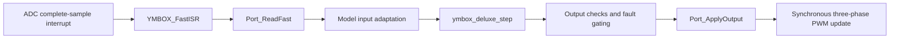

<a id="zh"></a>

**简体中文** | [English](#en)

# YMBOX 硬件接入

本接口采用单电机、单个控制中断调用者。固定封装调用生成代码的 `ymbox_deluxe_initialize()` / `ymbox_deluxe_step()`；板级只实现 `ymbox_port.h`。保留模型内部的 MDTM 分频，不在中断外重复执行慢环。当前模型的快环周期以本次导出的 `ymbox_build_info.h` 为准。


## 1. 导出

先用计算器保存完整配置，保存模型，然后在 MATLAB 执行：

```matlab
YMBOX_Deluxe_init;
result = YMBOX_ExportHardwarePackage;
```

输出在模型目录同级的 `ymbox_deluxe_outputs/hardware/<时间>/`。也可显式指定新目录及目标生产硬件：

```matlab
result = YMBOX_ExportHardwarePackage('D:/Work/YMBOX_C2000', ...
    'Texas Instruments->C2000');
```

第二个参数为空时沿用模型保存的硬件目标：代码生成外壳与控制核心默认均为 `Texas Instruments->C2000`。换 MCU 必须匹配 Simulink Hardware Implementation、编译器、浮点 ABI 和数学后端；移植包是 C 源码包，不是跨 CPU 通用二进制。不同目标的代码生成/编译和实际硬件验证是独立步骤。生成时临时设置会恢复，不保存到原模型。

`YMBOX_HardwarePackage.zip` 包含：

| 内容 | 用途 |
|---|---|
| `generated/` | 本次完整代码生成的顶层、引用模型与依赖源码 |
| `include/`、`source/` | 固定运行层、已有 DriveFramework、模型适配层 |
| `Platform/PortTemplate/ymbox_port.c` | 复制到板级工程后填写的模板 |
| `Platform/SharedMath/` 等 | 现有数学后端及构建选择 |
| `configuration/YMBOX_ActiveConfiguration.json` | 本次生成所用配置快照 |
| `include/ymbox_build_info.h` | 同一配置派生的周期、限值、能力契约及配置哈希 |
| `sources.txt`、`CMakeLists.txt` | 明确的源文件清单与 CMake 接入 |
| `defines.txt` | IDE 工程必须添加的编译宏，与本次角度计数配置一致 |
| `manifest.json` | 配置、目标、模型哈希、逐文件哈希及验证边界 |
| `integration_example.c` | 初始化、中断与命令接收示例，不自动参与编译 |

重新生成时使用新目录。不要手改生成参数或在生成源码中填驱动。

## 2. 实现板级文件

复制 `Platform/PortTemplate/ymbox_port.c` 到板级工程并实现所有必需函数。模板的初始化/采样/输出/复位函数默认失败；没有默认成功的弱符号驱动。最终固件必须且只能链接一个端口实现。

| 函数 | 调用环境与要求 |
|---|---|
| `YMBOX_Port_Init` | 主程序；检查实际定时器/采样/位置配置，开始调零，保持输出关闭和控制 IRQ 禁止 |
| `YMBOX_Port_ReadFast` | 控制 IRQ；读取已完成的一帧 ADC/DMA 数据，禁止等待转换或阻塞 SPI |
| `YMBOX_Port_ApplyOutput` | 短临界区；三相写影子比较寄存器，同一更新事件生效；关断必须操作实际 PWM/gate |
| `YMBOX_Port_Trip` | 初始化前、控制/故障 IRQ 均可调用；立即关闭并锁存；幂等 |
| `YMBOX_Port_ClearTrip` | 显式禁止运行的复位请求下调用；无活动故障才允许清锁存，成功后仍关闭输出；不得阻塞 |
| `YMBOX_Port_TimeUs` | 自由运行硬件微秒时钟，支持临界区读取和 uint32 回绕；不得用控制调用计数冒充 |
| `YMBOX_Port_EnterCritical/ExitCritical` | 保存/恢复原中断屏蔽状态，支持嵌套并提供编译器/内存屏障 |
| `YMBOX_Port_Background` | 可选；处理调零、温度、驱动诊断，并向采样层发布一致快照 |

`BoardInfo` 填硬件实际配置值，不能直接复制 `BuildInfo` 来绕过校验。基础能力为 gate 电源/逻辑、PWM、电流、电压反馈；没有独立 gate 电源引脚时，该能力表示已经具备等效的上电就绪条件。`readyFeatures` 中的 gate/PWM 位表示接口自检通过、可接受授权，不能用当前开关是否开启来填写，否则会造成等待使能的循环依赖。需要上电延迟的驱动由板级管理，尚未就绪时禁止实际 PWM 提交。

`supportedModes` 是板卡能力与生成算法能力的交集。第一版保守约定模式 1..5 需要位置反馈；模式 6 必须生成 Observer Variant 1，且由内部模式 16/17 执行。缺少母线电流传感器时，要在计算器选择模型的估算来源再重新生成，不能在“物理采样”配置下填写假的有效零值。

### 输入契约

- U/V/W 电流：A，正方向为流入对应电机相；完成 ADC 比例、偏置、相序和极性校正。
- 母线电压：V，物理未滤波值。母线电流：A，正方向为母线向逆变器供能。模型已有滤波继续在模型中执行。
- 位置：`uint32_t` 原生机械计数 `[0, positionCountsPerRev)`；与计算器每机械转计数一致，模型负责既有电角度换算/方向/PLL。禁止把弧度强转为计数。
- `sequence` 只随新的控制采样帧递增；`sampleTime_us` 是采集时刻，不能用读取时刻刷新旧数据。所有相关采样必须属于契约允许的同一周期。
- 位置若来自异步接口，由板级根据真实位置采样年龄决定 `YMBOX_VALID_POSITION`，不能因为 ADC 是新数据就把旧位置标为有效。
- `validMask` 分别表示三相电流、母线电压/电流及位置有效。NaN/Inf 会被禁止进入控制计算，并以无效输入报告。
- `hwFaultActive` 表示仍存在的硬件故障原因；硬件 trip 锁存由端口独立保持。把已消失的原因永久报为 active 会阻止恢复。
- `torqueLimitFactor` 为 `[0,1]`，不降额时填 1。平台故障/警告掩码按模型既有 MDFM 约定填写。
- 只有真实零点标定完成才设置 `currentZeroDone`；标定失败用 `currentZeroFailed`。第一次合格采样前不运行模型；之后即使出现故障，也继续逐拍处理模型诊断。

三相电流可由两电阻方案重构后提供，但必须满足同一帧的有效性约定。单电阻重构需要额外采样窗口/调制配合，本接口不自动实现该算法。

### PWM 与故障

占空比为归一化有效高侧导通比例；端口实现实际计数方式、相序、极性、互补输出及死区。三相必须在约定更新点一起生效。输出禁止是实际关断，不能用占空比 0 或 0.5 代替。

板级占空比限值、死区、控制/PWM 周期须匹配生成配置；改变这些值后重新生成。长期额外裁剪会破坏模型电压利用率与抗饱和反馈的一致性。

硬件比较器/驱动故障必须直接接到 PWM trip/break 路由，不能只靠下一拍软件关断。`ApplyOutput` 永远不得清 trip；故障在控制计算或输出提交期间发生也不能被普通使能覆盖。NMI 只执行硬件关断，不调用本运行库；多核访问不在本版范围内。

运行层检查过期/重复采样、启用命令超时、控制调用间隔丢拍、单次执行超期和无效输出。完全丢失控制中断时，软件没有机会运行这些检查，必须由板级独立看门狗/硬件输出超时机制保持关断。输出提交前后的微秒计时检查不替代精确 PWM 截止点和 WCET 的上板测量。

故障复位：持续发送新鲜的 `enable=false, clearFault=true` 命令（恢复计时期间保持通信）；硬件原因消失、采样就绪后端口清硬件锁存，模型继续 MDFM 恢复计时。模型锁存清除后再发送新的使能命令。复位函数成功本身不启用 PWM。

## 3. 固件调用

```c
Board_Init();                  /* 输出与控制 IRQ 关闭，硬件保护已配置 */
if (!YMBOX_Init()) {
    for (;;) { /* 保持关断，报告初始化失败 */ }
}
/* 只有初始化成功才启动 PWM 同步采样 */
Board_StartSampling();

/* 每一帧完整采样对应一次控制调用 */
void ADC_Control_IRQHandler(void)
{
    Board_AcknowledgeAdcIrq();  /* 应按本 MCU 的清标志要求安排顺序 */
    YMBOX_FastISR();
}

void PWM_Break_IRQHandler(void)
{
    YMBOX_TripISR(Board_ReadBreakCode());
    Board_AcknowledgeBreakIrq();
}
```

主循环调用 `YMBOX_Background()`。只有收到有效的新 CAN/串口/本地命令事件才调用 `YMBOX_SetCommand()`；相同目标值的新心跳可以接受，旧命令在后台重复调用不属于新通信。函数拒绝非法模式、非有限目标以及“使能同时清故障”，拒绝不会刷新命令年龄。

用 `YMBOX_GetStatus()` 取一致状态副本。快环独占模型与状态机，命令生产者和诊断读取者通过临界区交换。禁止其他任务直接写生成变量或调用 `ymbox_deluxe_step()`，禁止独立再调 MDTM。

## 4. 编译与验证

CMake 工程可以 `add_subdirectory(移植包目录)`，把 `ymbox` 链接到固件目标，并额外编译自己的端口文件。也可设置 `YMBOX_PORT_SOURCE`。Keil/CCS 等工程按 `sources.txt` 加源文件、按 `defines.txt` 加编译宏，并添加 `include`、`generated`、`Platform/{SharedMath,SinCos,Atan,Sqrt}` 头文件目录；板级同时负责数学后端要求的外设时钟与编译参数。

本版微秒时钟契约要求控制周期为整数微秒；不支持的分数微秒周期会在导出时明确报错。`YMBOX_Init()` 必须在所有软件调用者及控制/故障中断回调静止时执行，硬件保护通道持续有效。引用核心已开启显式内存初始化，重新初始化不会遗留前次模型状态；正常故障恢复仍使用清故障命令。

目标 MCU 的编译与上板验证由对应工具链和板卡完成。

不要开启会删除运行层 NaN/Inf 检查的有限数学假设。使用 C99 或更新标准；8 位语义字段采用 `uint_least8_t`，不假设 `char` 一定 8 位，不把 C 结构体直接序列化到通信总线。

模型仿真与主机测试不能替代目标 MCU 的编译、采样同步、PWM 极性、硬件保护或电机运行验证。上板前后需单独测量三相提交时刻、采样相位/延迟及含 MDTM 拍的最坏执行时间。

---

<a id="en"></a>

[简体中文](#zh) | **English**

# YMBOX Hardware Integration

This interface assumes a single motor and a single caller of the control interrupt. A fixed wrapper calls the generated `ymbox_deluxe_initialize()` / `ymbox_deluxe_step()`; the board only implements `ymbox_port.h`. The MDTM divider stays inside the model, so the slow loop is not executed again outside the interrupt. The fast-loop period of the current model is the one in the `ymbox_build_info.h` of this export.



## 1. Export

First save a complete configuration with the calculator and save the models, then run in MATLAB:

```matlab
YMBOX_Deluxe_init;
result = YMBOX_ExportHardwarePackage;
```

The output goes to `ymbox_deluxe_outputs/hardware/<timestamp>/` next to the model folder. You can also pass a new folder and the production hardware target explicitly:

```matlab
result = YMBOX_ExportHardwarePackage('D:/Work/YMBOX_C2000', ...
    'Texas Instruments->C2000');
```

When the second argument is empty, the hardware target saved in the models is used: both the code-generation shell and the control core default to `Texas Instruments->C2000`. Changing the MCU requires a matching Simulink Hardware Implementation, compiler, floating-point ABI and math backend; the package is a C source package, not a binary that is portable across CPUs. Code generation and compilation for another target, and verification on the real hardware, are separate steps. The temporary setting made during generation is restored afterwards and is not saved to the original models.

`YMBOX_HardwarePackage.zip` contains:

| Content | Purpose |
|---|---|
| `generated/` | Top-level model, referenced model and dependency sources of this complete code generation |
| `include/`, `source/` | Fixed runtime layer, the existing DriveFramework and the model adapter |
| `Platform/PortTemplate/ymbox_port.c` | Template to copy into the board project and fill in |
| `Platform/SharedMath/` etc. | Existing math backends and build selection |
| `configuration/YMBOX_ActiveConfiguration.json` | Snapshot of the configuration used for this generation |
| `include/ymbox_build_info.h` | Periods, limits, capability contract and configuration hash derived from the same configuration |
| `sources.txt`, `CMakeLists.txt` | Explicit source list and CMake integration |
| `defines.txt` | Compile definitions that an IDE project must add, consistent with the angle-count configuration of this export |
| `manifest.json` | Configuration, target, model hashes, per-file hashes and the verification boundary |
| `integration_example.c` | Example of initialization, interrupts and command reception; not compiled automatically |

Use a new folder for every regeneration. Do not edit generation parameters by hand, and do not write drivers inside the generated sources.

## 2. Implement the board file

Copy `Platform/PortTemplate/ymbox_port.c` into the board project and implement all required functions. The template's initialization, sampling, output and reset functions fail by default; there are no weak-symbol drivers that succeed by default. The final firmware must link exactly one port implementation.

| Function | Calling context and requirements |
|---|---|
| `YMBOX_Port_Init` | Main program; checks the actual timer/sampling/position configuration, starts zero calibration, and keeps the outputs off and the control IRQ disabled |
| `YMBOX_Port_ReadFast` | Control IRQ; reads one completed ADC/DMA frame; waiting for a conversion or blocking on SPI is forbidden |
| `YMBOX_Port_ApplyOutput` | Short critical section; writes the three-phase shadow compare registers so that they take effect on the same update event; a shutdown must act on the real PWM/gate |
| `YMBOX_Port_Trip` | Callable before initialization and from the control/fault IRQs; shuts down immediately and latches; idempotent |
| `YMBOX_Port_ClearTrip` | Called on a reset request with run explicitly disabled; the latch may be cleared only when no fault is active, and the outputs stay off after success; must not block |
| `YMBOX_Port_TimeUs` | Free-running hardware microsecond clock; supports reads inside critical sections and uint32 wraparound; must not be faked with a count of control calls |
| `YMBOX_Port_EnterCritical/ExitCritical` | Save/restore the previous interrupt mask, support nesting and provide compiler/memory barriers |
| `YMBOX_Port_Background` | Optional; handles zero calibration, temperature and driver diagnostics, and publishes a consistent snapshot to the sampling layer |

Fill `BoardInfo` with the values of the actual hardware configuration; do not copy `BuildInfo` to get around the check. The basic capabilities are gate power/logic, PWM, current and voltage feedback; when there is no separate gate-power pin, this capability means that an equivalent power-up-ready condition is met. The gate/PWM bits in `readyFeatures` mean that the interface self-check has passed and authorization can be accepted; do not fill them from whether the switch is currently on, otherwise waiting for the enable becomes a circular dependency. Drivers that need a power-up delay are managed by the board, and actual PWM commits are forbidden until they are ready.

`supportedModes` is the intersection of the board capabilities and the capabilities of the generated algorithm. The first version conservatively assumes that modes 1..5 need position feedback; mode 6 requires a generated Observer Variant 1 and is executed by the internal modes 16/17. Without a DC-bus current sensor, select the model's estimated source in the calculator and regenerate; do not report fake valid zeros under a "physical sampling" configuration.

### Input contract

- U/V/W currents: A, positive into the corresponding motor phase; ADC scale, offset, phase order and polarity already corrected.
- DC-bus voltage: V, unfiltered physical value. DC-bus current: A, positive when the bus supplies the inverter. The filters that already exist in the model keep running in the model.
- Position: `uint32_t` native mechanical counts in `[0, positionCountsPerRev)`, matching the counts per mechanical revolution set in the calculator; the model performs the existing electrical-angle conversion, direction handling and PLL. Casting radians to counts is forbidden.
- `sequence` increments only with a new control sample frame; `sampleTime_us` is the acquisition time, and old data must not be refreshed with the read time. All related samples must belong to the same period allowed by the contract.
- If the position comes from an asynchronous interface, the board decides `YMBOX_VALID_POSITION` from the real age of the position sample; an old position must not be flagged valid just because the ADC data are new.
- `validMask` flags the three phase currents, DC-bus voltage/current and position individually. NaN/Inf are kept out of the control calculation and reported as invalid input.
- `hwFaultActive` indicates a hardware fault cause that is still present; the hardware trip latch is held independently by the port. Reporting a cause that has disappeared as active forever prevents recovery.
- `torqueLimitFactor` is in `[0,1]`; use 1 when not derating. Fill the platform fault/warning masks according to the model's existing MDFM convention.
- Set `currentZeroDone` only after a real zero calibration has completed; use `currentZeroFailed` when calibration fails. The model does not run before the first qualified sample; after that, the model diagnostics keep being processed every step even when a fault occurs.

The three phase currents may be provided after reconstruction from a two-shunt scheme, but they must satisfy the same-frame validity convention. Single-shunt reconstruction needs additional sampling windows and cooperation from the modulation, which this interface does not implement automatically.

### PWM and faults

Duty cycles are normalized effective high-side conduction ratios; the port implements the actual counting mode, phase order, polarity, complementary outputs and dead time. All three phases must take effect together at the agreed update point. Disabling the outputs means a real shutdown and cannot be replaced by a duty cycle of 0 or 0.5.

The board's duty limits, dead time and control/PWM periods must match the generated configuration; regenerate after changing them. Permanent extra clipping breaks the consistency between the model's voltage utilization and its anti-windup feedback.

Hardware comparator/driver faults must be routed directly to the PWM trip/break input; a software shutdown in the next step alone is not enough. `ApplyOutput` must never clear a trip; a fault that occurs during the control calculation or the output commit must not be overridden by an ordinary enable either. An NMI only performs the hardware shutdown and does not call this runtime library; multi-core access is outside the scope of this version.

The runtime layer checks for stale or repeated samples, the timeout of the enabling command, missed steps in the control call interval, overruns of a single execution and invalid outputs. When the control interrupt is lost completely, the software has no chance to run these checks, so an independent board-level watchdog or hardware output-timeout mechanism must keep the outputs off. The microsecond timing checks before and after the output commit do not replace on-board measurements of the exact PWM deadline and the WCET.

Fault reset: keep sending fresh `enable=false, clearFault=true` commands (keep communicating during the recovery timing); once the hardware cause has gone and sampling is ready, the port clears the hardware latch and the model continues the MDFM recovery timing. Send a new enable command after the model latch has been cleared. A successful reset function does not by itself enable PWM.

## 3. Firmware calls

```c
Board_Init();                  /* outputs and control IRQ off, hardware protection configured */
if (!YMBOX_Init()) {
    for (;;) { /* stay off and report the initialization failure */ }
}
/* start PWM-synchronized sampling only after successful initialization */
Board_StartSampling();

/* one control call per complete sample frame */
void ADC_Control_IRQHandler(void)
{
    Board_AcknowledgeAdcIrq();  /* order this as the flag-clearing rules of your MCU require */
    YMBOX_FastISR();
}

void PWM_Break_IRQHandler(void)
{
    YMBOX_TripISR(Board_ReadBreakCode());
    Board_AcknowledgeBreakIrq();
}
```

The main loop calls `YMBOX_Background()`. Call `YMBOX_SetCommand()` only when a valid new CAN/serial/local command event has been received; a new heartbeat with the same target values is acceptable, whereas calling it repeatedly in the background with an old command is not new communication. The function rejects illegal modes, non-finite targets and "enable together with clear fault"; a rejection does not refresh the command age.

Use `YMBOX_GetStatus()` to get a coherent copy of the status. The fast loop owns the model and the state machine exclusively; command producers and diagnostic readers exchange data through critical sections. Other tasks must not write generated variables directly or call `ymbox_deluxe_step()`, and MDTM must not be called separately.

## 4. Build and verification

A CMake project can `add_subdirectory(<package folder>)`, link `ymbox` to the firmware target and compile its own port file in addition; alternatively set `YMBOX_PORT_SOURCE`. Projects such as Keil or CCS add the source files from `sources.txt` and the compile definitions from `defines.txt`, and add the include folders `include`, `generated` and `Platform/{SharedMath,SinCos,Atan,Sqrt}`; the board is also responsible for the peripheral clocks and compile options that the math backend requires.

The microsecond clock contract of this version requires the control period to be a whole number of microseconds; unsupported fractional-microsecond periods are reported as an explicit error at export time. `YMBOX_Init()` must run while all software callers and the control/fault interrupt callbacks are quiescent and the hardware protection channel remains active. The referenced core has explicit memory initialization enabled, so re-initialization leaves no state from the previous model run; normal fault recovery still uses the clear-fault command.

Compilation for the target MCU and on-board verification are done with the corresponding toolchain and board.

Do not enable finite-math assumptions that would remove the runtime layer's NaN/Inf checks. Use C99 or newer; fields with 8-bit semantics use `uint_least8_t`, `char` is not assumed to be 8 bits wide, and C structs are not serialized directly onto a communication bus.

Model simulation and host tests cannot replace compilation for the target MCU, sampling synchronization, PWM polarity, hardware protection or motor-run verification. Before and after going onto the board, measure separately the three-phase commit instant, the sampling phase/delay and the worst-case execution time including the MDTM step.
