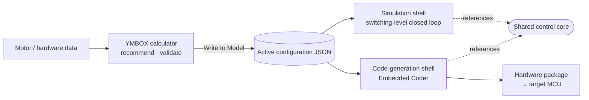
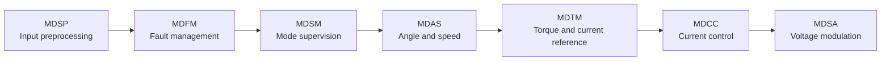

<a id="en"></a>

<div align="center">

# YMBOX Deluxe

**Open-source PMSM field-oriented control platform · MATLAB / Simulink**

[简体中文](README.md) | **English**

One control core runs both the switching-level closed-loop simulation and the C code generated for the MCU.<br>
The companion calculator derives the complete set of control parameters from the motor data, validates it and writes it to the model in one click.

<br>

[](#requirements)
[](#requirements)
[](#-code-generation-and-hardware-integration)
[](#-companion-calculator)
[](LICENSE)

[Quick Start](#-quick-start) · [Features](#-features) · [Calculator](#-companion-calculator) · [Architecture](#-control-architecture) · [Code Generation](#-code-generation-and-hardware-integration) · [Documentation](#-documentation)

</div>

<p align="center">
  <picture>
    <source media="(prefers-color-scheme: dark)" srcset="docs/images/sim-startup-en-dark.png">
    
  </picture>
  <br>
  <sub>The bundled KY130 example — open the model and click Run to reproduce it: after about 2.5 s of I/F open-loop drive the SMO observer takes over, and the motor reaches 3000 rpm at about 4.2 s. After the handover, the error between the control angle and the actual rotor electrical angle stays below 1°, with no faults throughout.</sub>
</p>

## ✨ Features

<table>
<tr>
<td width="33%" valign="top">

**🎯 One core, two shells**<br>
The simulation shell and the code-generation shell reference the same `YMBOX_Control_Core.slx` through Model Reference: the algorithm you verify in simulation is the algorithm generated for the chip.

</td>
<td width="33%" valign="top">

**🧭 Sensored + sensorless**<br>
Encoder / resolver sensored speed control; the sensorless mode is built on an extended back-EMF SMO + PLL and runs I/F startup → readiness check → handover → closed loop automatically.

</td>
<td width="33%" valign="top">

**🧮 Computed, traceable parameters**<br>
The calculator covers all 167 configuration fields: it recommends values from the motor and hardware data, shows the formula and source of each one, and writes them to the model in one click after validation.

</td>
</tr>
<tr>
<td valign="top">

**⚡ Switching-level simulation**<br>
PMSM, three-phase IGBT bridge and DC bus from Simscape Electrical, with per-switch dead time and a fixed-step discrete solver, so PWM ripple and dead-time effects are directly visible.

</td>
<td valign="top">

**🛡️ Complete fault management**<br>
Over/undervoltage, three-phase and dq software overcurrent, DC-bus current hard limit, phase-current sampling errors and a command watchdog; fault latching and an 8-entry event history.

</td>
<td valign="top">

**🔌 Straight to the MCU**<br>
Embedded Coder generates ERT C code (TI C2000 by default), shipped with a runtime layer, a safety state machine, a board port template and interchangeable math backends.

</td>
</tr>
</table>

### Key specifications

| Item | Specification |
| --- | --- |
| Motor type | Surface-mounted SPMSM (direct current allocation) / interior IPMSM (offline MTPA lookup) |
| Position feedback | Sensored: 2¹²–2²⁴ counts per mechanical revolution with a speed-estimation PLL; sensorless: I/F open-loop startup + extended back-EMF SMO + PLL, with optional adaptive gain scheduling |
| Control loops | d/q current PI (voltage anti-windup), speed PI (optional final I<sub>q</sub> anti-windup), voltage / angle feedforward, voltage reconstruction and optional inverter nonlinearity compensation |
| High-speed operation | MTPA and voltage-feedback field weakening with a demagnetization current floor; field weakening is available in sensored modes only |
| Control frequency | 4–20 kHz, divided exactly from a 1 μs base tick (4 / 5 / 8 / 10 / 20 kHz recommended); the PWM frequency is an integer multiple of the control frequency |
| Task structure | The fast loop runs every control step; the MDTM slow loop runs on a divider, default ÷10, configurable from 1 to 65535 |
| Electrical angle resolution | 4096 or 8192 counts per electrical revolution |
| Simulation plant | Simscape Electrical (Specialized Power Systems) PMSM + three-phase bridge + DC bus, per-switch dead time, fixed-step discrete solver |
| Code generation | Embedded Coder (ERT), default target TI C2000, entry points `ymbox_deluxe_initialize()` / `ymbox_deluxe_step()` |

## 🧭 Workflow



All run-time parameters have a single source: `ProjectConfiguration/ApplicationParameters/YMBOX_ActiveConfiguration.json`, written by the calculator. The model initializes itself when it is loaded, and reads, validates and derives the parameters when it is updated; if the configuration is missing or incomplete it reports an error instead of falling back to default values.

## 🚀 Quick Start

### Requirements

| Use | You need |
| --- | --- |
| Closed-loop simulation | MATLAB **R2024b**, Simulink, Stateflow, Simscape, Simscape Electrical, DSP System Toolbox (and its dependency, Signal Processing Toolbox) |
| Code generation | The products above, plus MATLAB Coder, Simulink Coder and Embedded Coder |
| Companion calculator | Python 3 (verified on 3.11, standard library only) and Edge or Chrome; computing and writing the configuration does not require MATLAB |

> [!NOTE]
> The models are saved in R2024b and were developed and verified in that release; earlier releases cannot open them.

### Run in three steps

1. **Get the project**: clone or download this repository and keep the folder structure intact. The repository root is the model folder; simulation caches and generated code are written to `<repository folder name>_outputs/` next to the repository, never into the source tree.
2. **Open the model**: open `YMBOX_Deluxe_sim.slx` in MATLAB. Loading it runs `YMBOX_Deluxe_init.m` automatically, which sets up the paths, the unit database, the bus objects and the global constants.
3. **Click Run**: the model reads and validates the active configuration, and the Command Window shows:

   ```text
   YMBOX initialization complete: simulation, control 20000 Hz, PWM 20000 Hz, profile KY130ACJS0435-30, warnings 0.
   ```

The bundled active configuration is the KY130 example shown above: 48 V DC bus, sensorless mode, 3000 rpm target, no load. Switching-level simulation is slow: with a 0.25 μs power-stage step, each simulated second takes about 1.5 minutes on an ordinary desktop, and the default duration is 10 s. To look at startup only, shorten "Simulation Duration" in calculator group 13 and write it to the model.

### Inspect the results

| Top-level block | Shows |
| --- | --- |
| `Scope3` / `Wm` | Mechanical speed (rpm / rad/s) |
| `Scope1` | Electromagnetic torque (N·m) |
| `Scope2` | Three-phase currents (A) |
| `Display1`–`Display3` | U / V / W duty cycles |

The six output buses of the control core are at the output ports of `EV_MCU_Application/MCU_Application_Strategy/App_Strategy`; enable signal logging there to inspect the operating mode, current commands, fault status and more.

## 🧮 Companion Calculator

The YMBOX configuration calculator is a local web tool: import the motor parameters, and it recommends every control parameter from formulas and, after validation, writes them straight into the active configuration used by the model.

<p align="center">
  
  <br>
  <sub>Left: profile management, validation and one-click write　·　Right: every recommended value comes with its formula, basis and source</sub>
</p>

**Launch**: double-click `Tools/Calculator/Launch YMBOX Configuration.pyw`, or run this from the repository root:

```bash
python Tools/Calculator/ymbox_config_server.py
```

Your browser opens the "YMBOX Configuration" page. The service listens on `127.0.0.1` only and uses a session token; the UI is in English by default, and you can switch to Chinese in the top-right corner.

**Tuning loop**:

1. Select an example under "Saved YMBOX Profiles", or import your own motor under "Motor Parameter Profile".
2. Click "Update / Complete Parameters" to recompute every parameter that is not manually locked from the current motor and hardware data.
3. Click "Validate Parameters"; when validation passes, click "Write to Model".
4. Return to Simulink and click Run again. You never need to close the model or edit a `.m` file.

> [!TIP]
> The example profiles can be written directly, without clicking "Update / Complete Parameters" first. Update recomputes unlocked parameters such as the dead time, the power-stage step and the SMO switch speed under the current rules, so the results differ from the example's original values. When you move to your own hardware, first enter measured values for the dead time, device voltage drops, noise and so on (which locks them as manual settings), then run Update.

**Generate code without simulating**: click "Generate Code Without Simulation". The tool recomputes with the current parameters and generates code in a fresh MATLAB batch process, writing to `<repository folder name>_outputs/direct-codegen/` without touching the active configuration. It requires `matlab` on the system PATH, or the environment variable `YMBOX_MATLAB_EXECUTABLE`.

Thirteen functional groups cover the whole configuration: build, motor, task timing and PWM, current loop, speed loop, voltage limits and inverter compensation, DC-bus measurement and protection, MTPA and field weakening, position feedback and math backends, SMO, startup and handover, voltage and angle feedforward, and simulation settings. The configuration file has 167 fields; the page shows 165 of them and maintains the other two automatically. Four example profiles (KY130 and EMRAX 208, each with a no-load and a rated-load variant) are in `Tools/Calculator/YMBOX_Data/Profiles/`.

## 🧩 Control Architecture

The control core consists of seven modules that run in a fixed order every control period; the MDTM slow loop runs on a divider (default ÷10), and a reset request can trigger it ahead of schedule.



| Module | Responsibility |
| --- | --- |
| **MDSP** Input preprocessing | Collects commands and raw samples; handles single-phase current reconstruction, position counts, DC-bus voltage and DC-bus current |
| **MDFM** Fault management | Fault confirmation, arbitration, latching and clearing; outputs stop, PWM-disable, PI-reset and derating requests |
| **MDSM** Mode supervision | Converts the public mode request into the internal operating mode and supervises I/F startup, SMO handover, loss of lock and exit |
| **MDAS** Angle and speed | Sensored PLL, voltage reconstruction, SMO observer, I/F trajectory and angle / speed handover |
| **MDTM** Torque and current reference (slow loop) | Speed PI, startup and handover current, MTPA, field weakening and current constraints |
| **MDCC** Current control | Clarke / Park transforms, d/q current PI, decoupling feedforward and dq software overcurrent detection |
| **MDSA** Voltage modulation | Inverter compensation, voltage-circle limiting, angle feedforward, inverse Park, SVPWM and duty-cycle constraints |

<details>
<summary><b>The control core in Simulink</b></summary>
<br>

</details>

### Operating modes

| No. | Mode | Description |
| --- | --- | --- |
| 0 | GateOff | Off, no control output |
| 1 | αβ voltage open loop | Applies U<sub>α</sub> / U<sub>β</sub> from the test commands; for power-stage and wiring checks |
| 2 | dq voltage open loop | Applies U<sub>d</sub> / U<sub>q</sub> from the test commands |
| 3 | dq current closed loop | Regulates I<sub>d</sub> / I<sub>q</sub> to the test commands; for current-loop tuning |
| 4 | Sensored speed loop | Speed control using the position sensor |
| 5 | Torque control | Controls to the target torque and allocates current through MTPA / field weakening |
| 6 | Sensorless speed request | Internally runs I/F startup → SMO readiness check → handover → sensorless closed loop; requires the SMO build |

The observer build is a compile-time choice: 0 is the sensored-only build and 1 is the SMO build (which contains both the sensored and the sensorless paths); validation rejects the combination "build 0 + mode 6". The current reference is selected automatically from the motor type: SPMSM pass-through or IPMSM MTPA. Modes 7–10 are reserved.

## 🔌 Code Generation and Hardware Integration

| Method | When to use | Details |
| --- | --- | --- |
| **Generate from the calculator** | You only need code | Click "Generate Code Without Simulation"; code is generated in a fresh MATLAB batch process without touching the active configuration |
| **Export a hardware package** | First integration on a new board | `YMBOX_ExportHardwarePackage(outputFolder)` exports the generated code, runtime layer, port template, math backends, a configuration snapshot and a build manifest |
| **Incremental update** | An already integrated CCS project | `YMBOX_UpdateGeneratedCode(profileJson, projectFolder)` synchronizes only the generated code and the configuration snapshot without touching hand-written sources; it refuses to update when timing, dead time, position counts or math backends change |

The board only has to implement the nine functions in `ymbox_port.h` (initialization, reading samples, applying duty cycles, trip and trip clear, a microsecond time base, critical sections and a background task); the firmware then calls the runtime layer like this:

```c
#include "ymbox_runtime.h"

int main(void)
{
    Board_Init();                       /* hardware protection armed, outputs off */
    if (!YMBOX_Init()) {                /* build config must match the board, else stay off */
        for (;;) { }
    }
    Board_StartSampling();              /* PWM triggers the ADC; the bridge is not enabled yet */
    for (;;) {
        YMBOX_Background();
    }
}

void ADC_Control_IRQHandler(void)       /* once per control period */
{
    Board_AcknowledgeAdcIrq();
    YMBOX_FastISR();
}

void PWM_Break_IRQHandler(void)         /* hardware has already tripped; latch the stop */
{
    YMBOX_TripISR(Board_ReadBreakCode());
    Board_AcknowledgeBreakIrq();
}
```

Commands such as mode, speed, torque and enable are sent with `YMBOX_SetCommand()`, and the status is read with `YMBOX_GetStatus()`. The math backends (TI TMU, STM32 CORDIC / FPU, lookup tables, generic C) are selected in the calculator, and the board-level CMake links only the selected implementation through `ymbox_link_shared_math(firmware)`.

The Hardware Implementation of the code-generation shell and the control core defaults to TI C2000. For other MCUs, set the same device type in both models, or pass it temporarily as the second argument when exporting the hardware package; this setting mainly affects the integer word sizes of the generated code and does not affect the control algorithm.

> [!WARNING]
> All of these methods only generate code — they **do not compile or flash firmware, and never start a motor**. Integration steps, port function contracts and the safety state machine are described in [`Platform/PortTemplate/HARDWARE_PORT.md`](Platform/PortTemplate/HARDWARE_PORT.md#en).

## 📁 Repository Layout

```text
ymbox_deluxe/
├── YMBOX_Deluxe_sim.slx          Closed-loop simulation entry: motor, inverter and controller
├── YMBOX_Deluxe_code.slx         Code-generation entry (ERT)
├── YMBOX_Control_Core.slx        Shared control core
├── YMBOX_Deluxe_init.m / _exit.m Initialization and exit cleanup, called by model callbacks
├── YMBOX_GenerateCodeOnly.m      Batch entry used by the calculator's direct code generation
├── YMBOX_UpdateGeneratedCode.m   Incremental update of generated code in an integrated project
├── ProjectConfiguration/         Active configuration JSON, field catalog, timing and mode definitions,
│                                 initialization flow, export tools
├── CoreLibrary/                  Parameter libraries of the 7 modules, parameter derivation and validation,
│                                 shared math library, bus definitions
├── CommonLibrary/                Input definitions and engineering units
├── Platform/
│   ├── Runtime/                  Runtime layer, Drive safety framework and model adapter
│   ├── PortTemplate/             Board port template, CMake integration example and HARDWARE_PORT.md
│   └── SharedMath/ SinCos/ Atan/ Sqrt/
│                                 Multi-platform math backends and lookup tables
├── Tools/Calculator/             YMBOX configuration calculator and example profiles
└── docs/images/                  README images
```

## 📌 Scope and Limitations

YMBOX is positioned as an **algorithm research platform and engineering starting point**, not a safety-certified product ready for vehicle deployment.

- **Bundled examples**: all four example profiles are surface-mounted motors with 20 kHz control, the SMO build and sensorless mode 6. The motor parameters in the examples are for demonstration only; before connecting your own motor, rely on measured or manufacturer data.
- **Validate for your application**: sensorless startup from an arbitrary initial angle or under load, reversal, sensorless field weakening (currently always off), full MTPA / field-weakening operation, inductance saturation and temperature drift, and the calibration of active inverter nonlinearity compensation on the target power board.
- **Calculator recommendations** are well-founded starting values, not optimal values for real hardware; protection thresholds, demagnetization limits, noise and device parameters must be confirmed against the actual hardware and motor data.
- **Before bench testing**, complete target compilation and SIL / PIL / HIL verification, and measure the interrupt execution time, the sampling-to-PWM alignment and the hardware overcurrent protection.

> [!CAUTION]
> Motor drives involve high voltage, high current and fast rotating parts. Make sure the hardware protection works before running on real hardware; this project is provided "as is", without warranty of any kind.

## 📖 Documentation

The full user manual is available in Chinese and English and contains the chapters below.

**Read online**: [English manual](https://sable-bite-ceb.notion.site/YMBOX-English-3ee77ff23ca58108b8c9fa561b562d5f) · [中文手册](https://sable-bite-ceb.notion.site/YMBOX-3ac77ff23ca58143824fdbed07e54605)

| Chapter | Contents |
| --- | --- |
| [YMBOX Configuration Calculator Guide](https://sable-bite-ceb.notion.site/3ee77ff23ca5817d921ecac318c50120) | Launching the calculator, importing a motor, one-click recommendations, writing to the model and direct code generation |
| [YMBOX Calculator Algorithms and Tuning Formulas](https://sable-bite-ceb.notion.site/3ee77ff23ca5819fb9fbe9517a56b292) | The formulas, assumptions and conditions behind every recommended value, plus an index of all configuration fields |
| [Project Overview and Model Architecture](https://sable-bite-ceb.notion.site/3ee77ff23ca58119840adbd1ba39067f) | Shared core, parameter configuration chain, control scheduling, simulation power stage and interface boundaries |
| [Modes, Variants and Parameter Naming](https://sable-bite-ceb.notion.site/3ee77ff23ca581b3a3ebd430c701245d) | Public and internal operating modes, build variants and parameter naming rules |
| [Control Modules](https://sable-bite-ceb.notion.site/3ee77ff23ca581c49bf3c95b40b45998) | Interfaces, parameters and processing rules of the seven modules, in execution order |
| [I/F Startup and SMO](https://sable-bite-ceb.notion.site/3ee77ff23ca581498fbdcc51099fa320) | The cross-module flow of startup, observation and handover, plus SMO parameter tuning |
| [Drive Framework and Board Integration](https://sable-bite-ceb.notion.site/3ee77ff23ca581d0af8fda611147e13e) | Exporting the hardware package, implementing the board port, firmware calls, incremental updates and the safety state machine |

Hardware integration notes in the repository: [`HARDWARE_PORT.md`](Platform/PortTemplate/HARDWARE_PORT.md#en) · [`SharedMath`](Platform/SharedMath/README.md#en) · [`SinCos`](Platform/SinCos/README.md)

## 📄 License

This project is released under the [Mozilla Public License 2.0](LICENSE). Third-party assets used by the calculator UI keep their own licenses: Animal Island UI (MIT), and the Nunito and Noto Sans SC fonts (SIL OFL 1.1); see [`Tools/Calculator/assets/README.md`](Tools/Calculator/assets/README.md#en).
