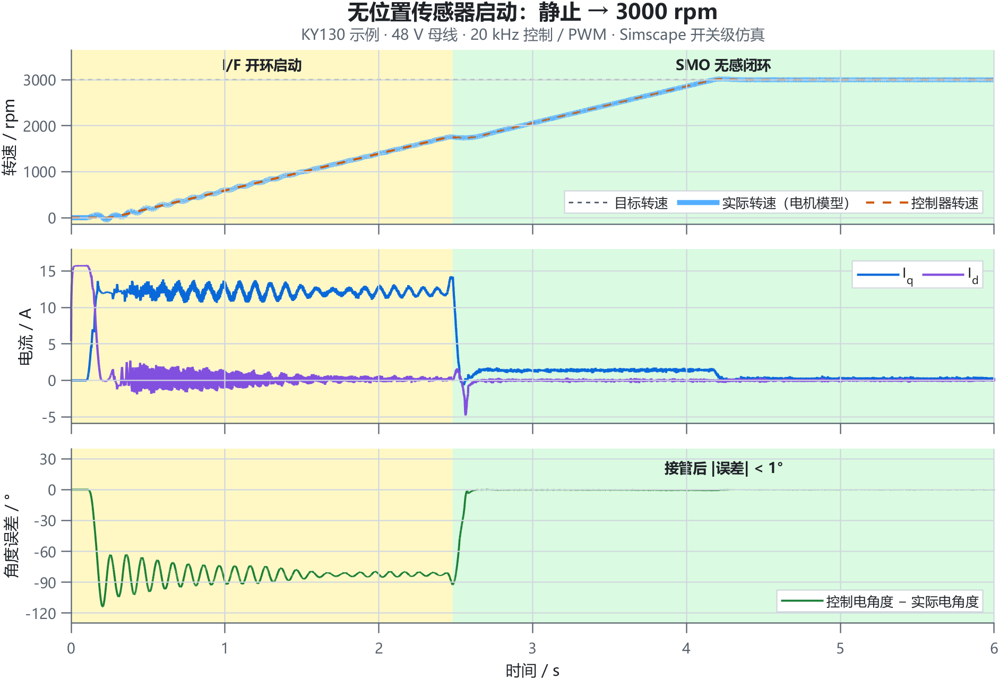
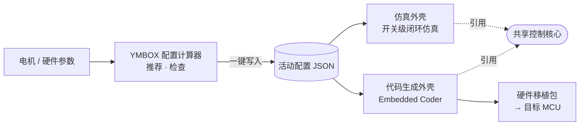
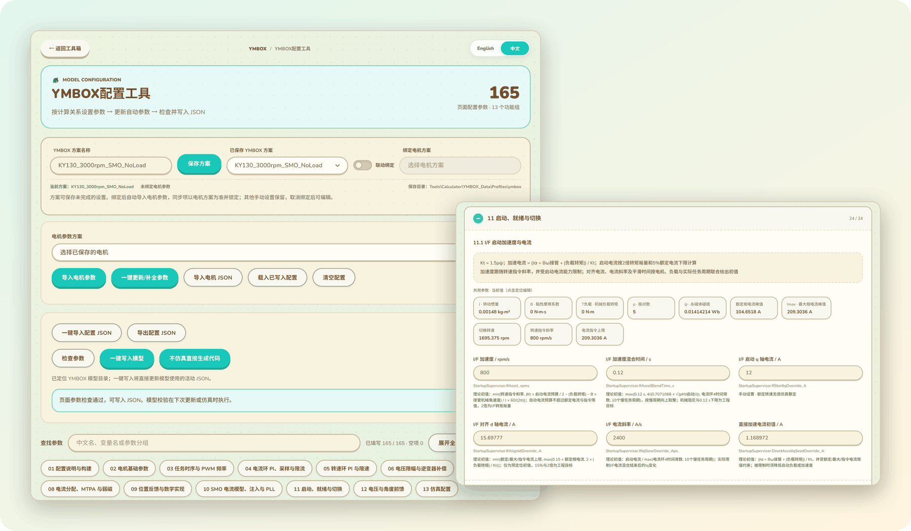
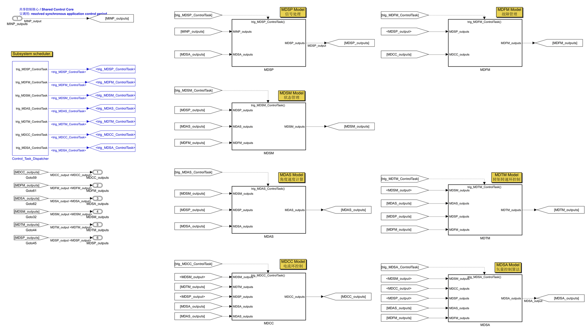
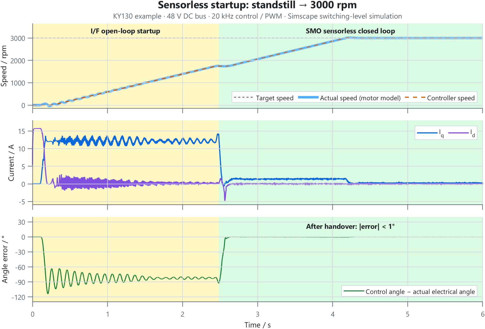
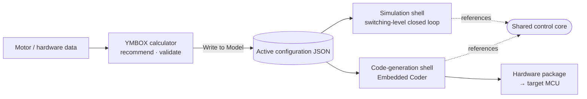
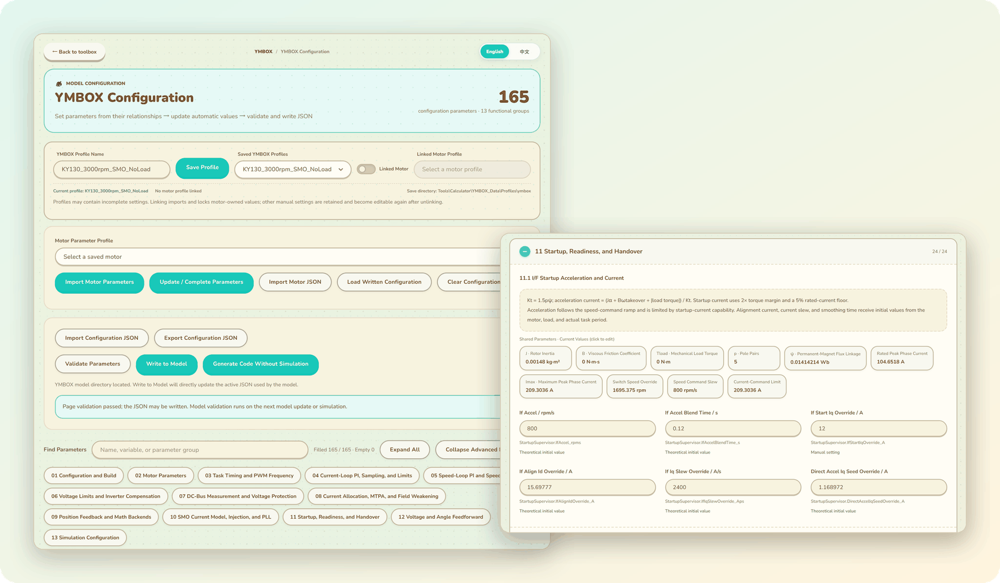
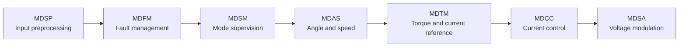

<a id="zh"></a>

<div align="center">

# YMBOX Deluxe

**开源永磁同步电机（PMSM）磁场定向控制平台 · MATLAB / Simulink**

**简体中文** | [English](#en)

一个控制核心，既跑开关级闭环仿真，也生成运行在 MCU 上的 C 代码。<br>
配套计算器从电机参数推算整套控制参数，检查通过后一键写入模型。

<sub>Open-source sensored / sensorless PMSM FOC platform for MATLAB/Simulink — one control core for switching-level simulation and Embedded Coder C code. <a href="#en">Read in English ↓</a></sub>

<br>

[](#环境要求)
[](#环境要求)
[](#-代码生成与硬件接入)
[](#-配套计算器)
[](LICENSE)

[快速开始](#-快速开始) · [特性](#-特性) · [配套计算器](#-配套计算器) · [控制架构](#-控制架构) · [代码生成](#-代码生成与硬件接入) · [文档](#-文档)

</div>

<p align="center">
  <picture>
    <source media="(prefers-color-scheme: dark)" srcset="docs/images/sim-startup-zh-dark.png">
    
  </picture>
  <br>
  <sub>随附的 KY130 示例，打开模型直接 Run 即可复现：I/F 开环拖动约 2.5 s 后由 SMO 观测器接管，约 4.2 s 到达 3000 rpm；接管完成后，控制电角度与转子实际电角度的误差小于 1°，全程无故障。</sub>
</p>

## ✨ 特性

<table>
<tr>
<td width="33%" valign="top">

**🎯 一核两用**<br>
仿真外壳与代码生成外壳通过 Model Reference 引用同一个 `YMBOX_Control_Core.slx`：仿真里验证的算法，就是生成到芯片里的算法。

</td>
<td width="33%" valign="top">

**🧭 有感 + 无感**<br>
编码器 / 旋变有感转速闭环；无感模式基于扩展反电势 SMO + PLL，自动完成 I/F 启动 → 就绪判定 → 接管 → 闭环。

</td>
<td width="33%" valign="top">

**🧮 参数可算、可查**<br>
计算器覆盖全部 167 项配置：按电机与硬件参数给出推荐值并附公式与来源，检查通过后一键写入模型。

</td>
</tr>
<tr>
<td valign="top">

**⚡ 开关级仿真**<br>
Simscape Electrical 的 PMSM、三相 IGBT 桥与直流母线，逐管死区、固定步长离散求解，PWM 纹波与死区效应都能直接观察。

</td>
<td valign="top">

**🛡️ 完整的故障管理**<br>
过压 / 欠压、三相与 dq 软件过流、母线电流硬限、相电流采样错误、命令看门狗；故障锁存与 8 条事件历史。

</td>
<td valign="top">

**🔌 直达 MCU**<br>
Embedded Coder 生成 ERT C 代码（默认 TI C2000），附运行层、安全状态机、板级端口模板与可替换的数学后端。

</td>
</tr>
</table>

### 主要规格

| 项目 | 规格 |
| --- | --- |
| 电机类型 | 表贴式 SPMSM（直通电流分配）/ 内嵌式 IPMSM（离线 MTPA 查表） |
| 位置反馈 | 有感：每机械圈 2¹²–2²⁴ 计数，带测速 PLL；无感：I/F 开环启动 + 扩展反电势 SMO + PLL，可选自适应增益调度 |
| 控制环路 | d/q 电流 PI（电压抗饱和）、转速 PI（可选最终 I<sub>q</sub> 抗饱和）、电压 / 角度前馈、电压重构与可选逆变器非线性补偿 |
| 高速运行 | MTPA 与电压反馈弱磁，带退磁电流下限；弱磁仅在有感模式下可用 |
| 控制频率 | 4–20 kHz，基于 1 μs 基准 tick 精确分频（推荐 4 / 5 / 8 / 10 / 20 kHz）；PWM 频率为控制频率的整数倍 |
| 任务结构 | 快环每拍执行；MDTM 慢环按分频执行，默认 ÷10，可设 1–65535 |
| 电角度分辨率 | 每电角圈 4096 或 8192 计数 |
| 仿真对象 | Simscape Electrical（Specialized Power Systems）PMSM + 三相桥 + 直流母线，逐管死区，固定步长离散求解 |
| 代码生成 | Embedded Coder（ERT），默认目标 TI C2000，入口函数 `ymbox_deluxe_initialize()` / `ymbox_deluxe_step()` |

## 🧭 工作流程



全部运行参数只有一个来源：计算器写入的 `ProjectConfiguration/ApplicationParameters/YMBOX_ActiveConfiguration.json`。模型加载时自动初始化，更新时读取、校验并派生参数；配置缺失或不完整时直接报错，不会退回默认值运行。

## 🚀 快速开始

### 环境要求

| 用途 | 需要 |
| --- | --- |
| 闭环仿真 | MATLAB **R2024b**、Simulink、Stateflow、Simscape、Simscape Electrical、DSP System Toolbox（及其依赖的 Signal Processing Toolbox） |
| 代码生成 | 以上产品，以及 MATLAB Coder、Simulink Coder、Embedded Coder |
| 配套计算器 | Python 3（已在 3.11 上验证，只用标准库）与 Edge 或 Chrome；计算与写入配置不需要 MATLAB |

> [!NOTE]
> 模型以 R2024b 保存，开发与验证均在此版本完成，更早的版本无法打开。

### 三步运行

1. **获取工程**：克隆或下载本仓库，保持目录结构不变。仓库根目录就是模型目录；仿真缓存与生成代码写在仓库旁的 `<仓库目录名>_outputs/`，不会写进源码目录。
2. **打开模型**：在 MATLAB 中打开 `YMBOX_Deluxe_sim.slx`。加载时自动运行 `YMBOX_Deluxe_init.m`，完成路径、单位库、总线对象和全局常量的初始化。
3. **点击 Run**：模型读取并校验活动配置，命令行窗口显示：

   ```text
   YMBOX initialization complete: simulation, control 20000 Hz, PWM 20000 Hz, profile KY130ACJS0435-30, warnings 0.
   ```

随附的活动配置就是上图的 KY130 示例：48 V 母线、无感模式、目标 3000 rpm、空载。开关级仿真较慢：功率级步长 0.25 μs，每仿真 1 s 在普通台式机上约需 1.5 分钟，默认仿真时长 10 s；只想看启动过程时，可在计算器第 13 组把「仿真时长」改短后写入。

### 查看结果

| 顶层模块 | 内容 |
| --- | --- |
| `Scope3` / `Wm` | 机械转速（rpm / rad/s） |
| `Scope1` | 电磁转矩（N·m） |
| `Scope2` | 三相电流（A） |
| `Display1`–`Display3` | U / V / W 三相占空比 |

控制核心的六条输出总线位于 `EV_MCU_Application/MCU_Application_Strategy/App_Strategy` 的输出端口，开启信号记录即可查看运行模式、电流指令、故障状态等。

## 🧮 配套计算器

YMBOX 配置计算器是一个本地网页工具：导入电机参数，它按公式推荐出全部控制参数，检查通过后直接写入模型使用的活动配置。

<p align="center">
  
  <br>
  <sub>左：方案管理、参数检查与一键写入　·　右：每个推荐值都附带公式、依据与来源</sub>
</p>

**启动**：双击 `Tools/Calculator/启动YMBOX配置工具.pyw`，或在仓库根目录运行：

```bash
python Tools/Calculator/ymbox_config_server.py
```

浏览器会打开「YMBOX 配置工具」页面。服务只监听 `127.0.0.1` 并使用会话令牌；界面默认英文，右上角可切换中文。

**调参循环**：

1. 在「已保存 YMBOX 方案」中选择示例方案，或在「电机参数方案」中导入自己的电机。
2. 点击「一键更新/补全参数」，按当前电机与硬件参数重算所有未手动锁定的参数。
3. 点击「检查参数」，通过后点击「一键写入模型」。
4. 回到 Simulink 再次 Run。整个过程无需关闭模型，也不需要编辑任何 `.m` 文件。

> [!TIP]
> 示例方案可以直接写入，不需要先点「一键更新」。一键更新会按当前规则重算死区、功率级步长、SMO 切换速度等未锁定参数，结果与示例原值不同。换成自己的硬件时，先把死区、器件压降、噪声等填成实测值（即锁定为手动设置），再执行一键更新。

**不仿真直接生成代码**：点击「不仿真直接生成代码」，工具按当前参数重算后，在新的 MATLAB 批处理进程中生成代码，输出到 `<仓库目录名>_outputs/direct-codegen/`，不改动活动配置。需要 `matlab` 在系统 PATH 中，或设置环境变量 `YMBOX_MATLAB_EXECUTABLE`。

13 个功能组覆盖全部配置：构建方式、电机、任务时序与 PWM、电流环、转速环、电压限幅与逆变器补偿、母线采样与保护、MTPA 与弱磁、位置反馈与数学实现、SMO、启动与切换、电压与角度前馈、仿真配置。配置文件共 167 个字段，页面显示其中 165 项，另外 2 项由页面自动维护。随附 4 个示例方案（KY130、EMRAX 208，各有空载与额定负载两套），位于 `Tools/Calculator/YMBOX_Data/Profiles/`。

## 🧩 控制架构

控制核心由 7 个模块组成，每个控制周期按固定顺序执行；MDTM 慢环按分频执行（默认 ÷10），复位请求可提前触发。


| 模块 | 职责 |
| --- | --- |
| **MDSP** 输入预处理 | 汇总命令与原始采样，处理单相电流重构、位置计数、母线电压与母线电流 |
| **MDFM** 故障管理 | 故障确认、仲裁、锁存与清除，输出停机、PWM 禁止、PI 复位与降额请求 |
| **MDSM** 模式监督 | 把公开模式请求转换为内部运行模式，监督 I/F 启动、SMO 接管、失锁与退出 |
| **MDAS** 角度与速度 | 有感 PLL、电压重构、SMO 观测器、I/F 轨迹与角度 / 速度接管 |
| **MDTM** 转矩与电流参考（慢环） | 转速 PI、启动与接管电流、MTPA、弱磁与电流约束 |
| **MDCC** 电流控制 | Clarke / Park 变换、d/q 电流 PI、解耦前馈与 dq 软件过流判定 |
| **MDSA** 电压调制 | 逆变器补偿、电压圆限幅、角度前馈、逆 Park、SVPWM 与占空比约束 |

<details>
<summary><b>Simulink 中的控制核心</b></summary>
<br>

</details>

### 运行模式

| 编号 | 模式 | 说明 |
| --- | --- | --- |
| 0 | GateOff | 关断，无控制输出 |
| 1 | αβ 电压开环 | 按测试指令给定 U<sub>α</sub> / U<sub>β</sub>，用于功率级与接线检查 |
| 2 | dq 电压开环 | 按测试指令给定 U<sub>d</sub> / U<sub>q</sub> |
| 3 | dq 电流闭环 | 按测试指令给定 I<sub>d</sub> / I<sub>q</sub>，用于电流环整定 |
| 4 | 有感转速闭环 | 使用位置传感器的转速控制 |
| 5 | 转矩控制 | 按目标转矩控制，经 MTPA / 弱磁分配电流 |
| 6 | 无感转速请求 | 内部自动完成 I/F 启动 → SMO 就绪判定 → 接管 → 无感闭环，需要 SMO 构建 |

观测器构建是编译期选择：0 为纯有感构建，1 为 SMO 构建（同时包含有感与无感路径），配置检查不允许「构建 0 + 模式 6」。电流参考随电机类型自动选择 SPMSM 直通或 IPMSM MTPA。模式 7–10 为保留编号。

## 🔌 代码生成与硬件接入

| 方式 | 适用场景 | 说明 |
| --- | --- | --- |
| **计算器直接生成** | 只需要生成代码 | 点击「不仿真直接生成代码」，在新的 MATLAB 批处理进程中生成，不改动活动配置 |
| **导出硬件移植包** | 首次接入一块新板卡 | `YMBOX_ExportHardwarePackage(输出目录)` 导出生成代码、运行层、端口模板、数学后端、配置快照和构建清单 |
| **增量更新** | 已集成的 CCS 工程 | `YMBOX_UpdateGeneratedCode(方案JSON, 工程目录)` 只同步生成代码与配置快照，不改动手写源码；时序、死区、位置计数或数学后端变化时拒绝更新 |

板级只需实现 `ymbox_port.h` 中的 9 个函数（初始化、读取采样、输出占空比、跳闸与清除、微秒时基、临界区与后台任务），固件按下面的方式调用运行层：

```c
#include "ymbox_runtime.h"

int main(void)
{
    Board_Init();                       /* 硬件保护就绪，输出关断 */
    if (!YMBOX_Init()) {                /* 核对构建配置与板卡能力，不一致则保持关断 */
        for (;;) { }
    }
    Board_StartSampling();              /* PWM 触发 ADC，此时尚未使能桥臂 */
    for (;;) {
        YMBOX_Background();
    }
}

void ADC_Control_IRQHandler(void)       /* 每个控制周期一次 */
{
    Board_AcknowledgeAdcIrq();
    YMBOX_FastISR();
}

void PWM_Break_IRQHandler(void)         /* 硬件已跳闸，锁存停机 */
{
    YMBOX_TripISR(Board_ReadBreakCode());
    Board_AcknowledgeBreakIrq();
}
```

模式、转速、转矩与使能等指令通过 `YMBOX_SetCommand()` 下发，状态通过 `YMBOX_GetStatus()` 读取。数学后端（TI TMU、STM32 CORDIC / FPU、查表、通用 C）在计算器中选择，板级 CMake 通过 `ymbox_link_shared_math(firmware)` 只链接所选实现。

代码生成外壳与控制核心的目标硬件默认设为 TI C2000。面向其他 MCU 时，在两个模型中设置相同的设备类型，或在导出移植包时用第二个参数临时指定；该设置主要影响生成代码的整数字长，不影响控制算法。

> [!WARNING]
> 以上方式都只生成代码，**不会编译、下载固件，也不会启动电机**。接入步骤、端口函数约定与安全状态机见 [`Platform/PortTemplate/HARDWARE_PORT.md`](Platform/PortTemplate/HARDWARE_PORT.md)。

## 📁 目录结构

```text
ymbox_deluxe/
├── YMBOX_Deluxe_sim.slx          闭环仿真入口：电机、逆变器与控制器
├── YMBOX_Deluxe_code.slx         代码生成入口（ERT）
├── YMBOX_Control_Core.slx        共享控制核心
├── YMBOX_Deluxe_init.m / _exit.m 初始化与退出清理，由模型回调自动调用
├── YMBOX_GenerateCodeOnly.m      计算器「直接生成代码」调用的批处理入口
├── YMBOX_UpdateGeneratedCode.m   增量更新已集成工程的生成代码
├── ProjectConfiguration/         活动配置 JSON、字段目录、时序与模式定义、初始化流程、导出工具
├── CoreLibrary/                  7 个模块的参数库、参数派生与校验、共享数学库、总线定义
├── CommonLibrary/                输入定义与工程单位
├── Platform/
│   ├── Runtime/                  运行层、Drive 安全框架与模型适配层
│   ├── PortTemplate/             板级端口模板、CMake 接入示例与 HARDWARE_PORT.md
│   └── SharedMath/ SinCos/ Atan/ Sqrt/
│                                 多平台数学后端与查表
├── Tools/Calculator/             YMBOX 配置计算器与示例方案
└── docs/images/                  README 配图
```

## 📌 适用范围

YMBOX 的定位是**算法研究与工程起点**，不是可以直接装车的安全认证产品。

- **随附示例**：4 个示例方案均为表贴式电机，控制频率 20 kHz，使用 SMO 构建与无感模式 6。示例中的电机参数仅作演示，接入自己的电机前请以实测或厂家数据为准。
- **需按应用验证**：任意初始角或带载的无感启动、反转、无感弱磁（当前固定关闭）、全 MTPA / 弱磁工况、电感饱和与温漂，以及主动逆变器非线性补偿在目标功率板上的标定。
- **计算器推荐值**是有依据的初值，不是实机最优值；保护阈值、退磁极限、噪声与器件参数必须结合实际硬件和电机数据确认。
- **上台架前**应完成目标编译、SIL / PIL / HIL 验证，并实测中断执行时间、采样与 PWM 的对齐以及硬件过流保护。

> [!CAUTION]
> 电机驱动涉及高电压、大电流和高速旋转部件。在真实硬件上运行前请确认硬件保护有效；本项目按「原样」提供，不附带任何担保。

## 📖 文档

完整的使用手册提供中文与英文两个版本，包含以下章节。

<!-- TODO(发布后填写)：在线手册发布后，把下一行换成链接，例如：
**在线阅读**：[中文手册](https://中文手册网址) · [English manual](https://英文手册网址)
-->
**在线阅读**：中文手册与英文手册即将发布。

| 章节 | 内容 |
| --- | --- |
| YMBOX 配置计算器使用指南 | 启动计算器、导入电机、一键推荐、写入模型与直接生成代码 |
| 计算器算法与整定公式原理 | 每一项推荐值背后的公式、假设和适用条件，以及全部配置字段索引 |
| 工程总览与模型架构 | 共享核心、参数配置链、控制调度、仿真功率级与接口边界 |
| 模式、Variant 与参数命名 | 公开与内部运行模式、构建 Variant 和参数命名规则 |
| 控制模块说明 | 按执行顺序说明 7 个模块的接口、参数与处理规则 |
| I/F 启动与 SMO | 启动、观测与接管的跨模块流程，以及 SMO 参数整定 |
| Drive 框架与板级接入 | 导出移植包、实现板级端口、固件调用、增量更新与安全状态机 |

仓库内的硬件接入说明：[`HARDWARE_PORT.md`](Platform/PortTemplate/HARDWARE_PORT.md) · [`SharedMath`](Platform/SharedMath/README.md) · [`SinCos`](Platform/SinCos/README.md)

## 📄 许可证

本项目以 [Mozilla Public License 2.0](LICENSE) 发布。计算器界面使用的第三方资源保留各自的许可：Animal Island UI（MIT）、Nunito 与 Noto Sans SC 字体（SIL OFL 1.1），详见 [`Tools/Calculator/assets/README.md`](Tools/Calculator/assets/README.md)。

<br>

---

<a id="en"></a>

<div align="center">

# YMBOX Deluxe

**Open-source PMSM field-oriented control platform · MATLAB / Simulink**

[简体中文](#zh) | **English**

One control core runs both the switching-level closed-loop simulation and the C code generated for the MCU.<br>
The companion calculator derives the complete set of control parameters from the motor data, validates it and writes it to the model in one click.

<br>

[](#requirements)
[](#requirements)
[](#-code-generation-and-hardware-integration)
[](#-companion-calculator)
[](LICENSE)

[Quick Start](#-quick-start) · [Features](#-features) · [Calculator](#-companion-calculator) · [Architecture](#-control-architecture) · [Code Generation](#-code-generation-and-hardware-integration) · [Documentation](#-documentation)

</div>

<p align="center">
  <picture>
    <source media="(prefers-color-scheme: dark)" srcset="docs/images/sim-startup-en-dark.png">
    
  </picture>
  <br>
  <sub>The bundled KY130 example — open the model and click Run to reproduce it: after about 2.5 s of I/F open-loop drive the SMO observer takes over, and the motor reaches 3000 rpm at about 4.2 s. After the handover, the error between the control angle and the actual rotor electrical angle stays below 1°, with no faults throughout.</sub>
</p>

## ✨ Features

<table>
<tr>
<td width="33%" valign="top">

**🎯 One core, two shells**<br>
The simulation shell and the code-generation shell reference the same `YMBOX_Control_Core.slx` through Model Reference: the algorithm you verify in simulation is the algorithm generated for the chip.

</td>
<td width="33%" valign="top">

**🧭 Sensored + sensorless**<br>
Encoder / resolver sensored speed control; the sensorless mode is built on an extended back-EMF SMO + PLL and runs I/F startup → readiness check → handover → closed loop automatically.

</td>
<td width="33%" valign="top">

**🧮 Computed, traceable parameters**<br>
The calculator covers all 167 configuration fields: it recommends values from the motor and hardware data, shows the formula and source of each one, and writes them to the model in one click after validation.

</td>
</tr>
<tr>
<td valign="top">

**⚡ Switching-level simulation**<br>
PMSM, three-phase IGBT bridge and DC bus from Simscape Electrical, with per-switch dead time and a fixed-step discrete solver, so PWM ripple and dead-time effects are directly visible.

</td>
<td valign="top">

**🛡️ Complete fault management**<br>
Over/undervoltage, three-phase and dq software overcurrent, DC-bus current hard limit, phase-current sampling errors and a command watchdog; fault latching and an 8-entry event history.

</td>
<td valign="top">

**🔌 Straight to the MCU**<br>
Embedded Coder generates ERT C code (TI C2000 by default), shipped with a runtime layer, a safety state machine, a board port template and interchangeable math backends.

</td>
</tr>
</table>

### Key specifications

| Item | Specification |
| --- | --- |
| Motor type | Surface-mounted SPMSM (direct current allocation) / interior IPMSM (offline MTPA lookup) |
| Position feedback | Sensored: 2¹²–2²⁴ counts per mechanical revolution with a speed-estimation PLL; sensorless: I/F open-loop startup + extended back-EMF SMO + PLL, with optional adaptive gain scheduling |
| Control loops | d/q current PI (voltage anti-windup), speed PI (optional final I<sub>q</sub> anti-windup), voltage / angle feedforward, voltage reconstruction and optional inverter nonlinearity compensation |
| High-speed operation | MTPA and voltage-feedback field weakening with a demagnetization current floor; field weakening is available in sensored modes only |
| Control frequency | 4–20 kHz, divided exactly from a 1 μs base tick (4 / 5 / 8 / 10 / 20 kHz recommended); the PWM frequency is an integer multiple of the control frequency |
| Task structure | The fast loop runs every control step; the MDTM slow loop runs on a divider, default ÷10, configurable from 1 to 65535 |
| Electrical angle resolution | 4096 or 8192 counts per electrical revolution |
| Simulation plant | Simscape Electrical (Specialized Power Systems) PMSM + three-phase bridge + DC bus, per-switch dead time, fixed-step discrete solver |
| Code generation | Embedded Coder (ERT), default target TI C2000, entry points `ymbox_deluxe_initialize()` / `ymbox_deluxe_step()` |

## 🧭 Workflow



All run-time parameters have a single source: `ProjectConfiguration/ApplicationParameters/YMBOX_ActiveConfiguration.json`, written by the calculator. The model initializes itself when it is loaded, and reads, validates and derives the parameters when it is updated; if the configuration is missing or incomplete it reports an error instead of falling back to default values.

## 🚀 Quick Start

### Requirements

| Use | You need |
| --- | --- |
| Closed-loop simulation | MATLAB **R2024b**, Simulink, Stateflow, Simscape, Simscape Electrical, DSP System Toolbox (and its dependency, Signal Processing Toolbox) |
| Code generation | The products above, plus MATLAB Coder, Simulink Coder and Embedded Coder |
| Companion calculator | Python 3 (verified on 3.11, standard library only) and Edge or Chrome; computing and writing the configuration does not require MATLAB |

> [!NOTE]
> The models are saved in R2024b and were developed and verified in that release; earlier releases cannot open them.

### Run in three steps

1. **Get the project**: clone or download this repository and keep the folder structure intact. The repository root is the model folder; simulation caches and generated code are written to `<repository folder name>_outputs/` next to the repository, never into the source tree.
2. **Open the model**: open `YMBOX_Deluxe_sim.slx` in MATLAB. Loading it runs `YMBOX_Deluxe_init.m` automatically, which sets up the paths, the unit database, the bus objects and the global constants.
3. **Click Run**: the model reads and validates the active configuration, and the Command Window shows:

   ```text
   YMBOX initialization complete: simulation, control 20000 Hz, PWM 20000 Hz, profile KY130ACJS0435-30, warnings 0.
   ```

The bundled active configuration is the KY130 example shown above: 48 V DC bus, sensorless mode, 3000 rpm target, no load. Switching-level simulation is slow: with a 0.25 μs power-stage step, each simulated second takes about 1.5 minutes on an ordinary desktop, and the default duration is 10 s. To look at startup only, shorten "Simulation Duration" in calculator group 13 and write it to the model.

### Inspect the results

| Top-level block | Shows |
| --- | --- |
| `Scope3` / `Wm` | Mechanical speed (rpm / rad/s) |
| `Scope1` | Electromagnetic torque (N·m) |
| `Scope2` | Three-phase currents (A) |
| `Display1`–`Display3` | U / V / W duty cycles |

The six output buses of the control core are at the output ports of `EV_MCU_Application/MCU_Application_Strategy/App_Strategy`; enable signal logging there to inspect the operating mode, current commands, fault status and more.

## 🧮 Companion Calculator

The YMBOX configuration calculator is a local web tool: import the motor parameters, and it recommends every control parameter from formulas and, after validation, writes them straight into the active configuration used by the model.

<p align="center">
  
  <br>
  <sub>Left: profile management, validation and one-click write　·　Right: every recommended value comes with its formula, basis and source</sub>
</p>

**Launch**: double-click `Tools/Calculator/Launch YMBOX Configuration.pyw`, or run this from the repository root:

```bash
python Tools/Calculator/ymbox_config_server.py
```

Your browser opens the "YMBOX Configuration" page. The service listens on `127.0.0.1` only and uses a session token; the UI is in English by default, and you can switch to Chinese in the top-right corner.

**Tuning loop**:

1. Select an example under "Saved YMBOX Profiles", or import your own motor under "Motor Parameter Profile".
2. Click "Update / Complete Parameters" to recompute every parameter that is not manually locked from the current motor and hardware data.
3. Click "Validate Parameters"; when validation passes, click "Write to Model".
4. Return to Simulink and click Run again. You never need to close the model or edit a `.m` file.

> [!TIP]
> The example profiles can be written directly, without clicking "Update / Complete Parameters" first. Update recomputes unlocked parameters such as the dead time, the power-stage step and the SMO switch speed under the current rules, so the results differ from the example's original values. When you move to your own hardware, first enter measured values for the dead time, device voltage drops, noise and so on (which locks them as manual settings), then run Update.

**Generate code without simulating**: click "Generate Code Without Simulation". The tool recomputes with the current parameters and generates code in a fresh MATLAB batch process, writing to `<repository folder name>_outputs/direct-codegen/` without touching the active configuration. It requires `matlab` on the system PATH, or the environment variable `YMBOX_MATLAB_EXECUTABLE`.

Thirteen functional groups cover the whole configuration: build, motor, task timing and PWM, current loop, speed loop, voltage limits and inverter compensation, DC-bus measurement and protection, MTPA and field weakening, position feedback and math backends, SMO, startup and handover, voltage and angle feedforward, and simulation settings. The configuration file has 167 fields; the page shows 165 of them and maintains the other two automatically. Four example profiles (KY130 and EMRAX 208, each with a no-load and a rated-load variant) are in `Tools/Calculator/YMBOX_Data/Profiles/`.

## 🧩 Control Architecture

The control core consists of seven modules that run in a fixed order every control period; the MDTM slow loop runs on a divider (default ÷10), and a reset request can trigger it ahead of schedule.



| Module | Responsibility |
| --- | --- |
| **MDSP** Input preprocessing | Collects commands and raw samples; handles single-phase current reconstruction, position counts, DC-bus voltage and DC-bus current |
| **MDFM** Fault management | Fault confirmation, arbitration, latching and clearing; outputs stop, PWM-disable, PI-reset and derating requests |
| **MDSM** Mode supervision | Converts the public mode request into the internal operating mode and supervises I/F startup, SMO handover, loss of lock and exit |
| **MDAS** Angle and speed | Sensored PLL, voltage reconstruction, SMO observer, I/F trajectory and angle / speed handover |
| **MDTM** Torque and current reference (slow loop) | Speed PI, startup and handover current, MTPA, field weakening and current constraints |
| **MDCC** Current control | Clarke / Park transforms, d/q current PI, decoupling feedforward and dq software overcurrent detection |
| **MDSA** Voltage modulation | Inverter compensation, voltage-circle limiting, angle feedforward, inverse Park, SVPWM and duty-cycle constraints |

<details>
<summary><b>The control core in Simulink</b></summary>
<br>

</details>

### Operating modes

| No. | Mode | Description |
| --- | --- | --- |
| 0 | GateOff | Off, no control output |
| 1 | αβ voltage open loop | Applies U<sub>α</sub> / U<sub>β</sub> from the test commands; for power-stage and wiring checks |
| 2 | dq voltage open loop | Applies U<sub>d</sub> / U<sub>q</sub> from the test commands |
| 3 | dq current closed loop | Regulates I<sub>d</sub> / I<sub>q</sub> to the test commands; for current-loop tuning |
| 4 | Sensored speed loop | Speed control using the position sensor |
| 5 | Torque control | Controls to the target torque and allocates current through MTPA / field weakening |
| 6 | Sensorless speed request | Internally runs I/F startup → SMO readiness check → handover → sensorless closed loop; requires the SMO build |

The observer build is a compile-time choice: 0 is the sensored-only build and 1 is the SMO build (which contains both the sensored and the sensorless paths); validation rejects the combination "build 0 + mode 6". The current reference is selected automatically from the motor type: SPMSM pass-through or IPMSM MTPA. Modes 7–10 are reserved.

## 🔌 Code Generation and Hardware Integration

| Method | When to use | Details |
| --- | --- | --- |
| **Generate from the calculator** | You only need code | Click "Generate Code Without Simulation"; code is generated in a fresh MATLAB batch process without touching the active configuration |
| **Export a hardware package** | First integration on a new board | `YMBOX_ExportHardwarePackage(outputFolder)` exports the generated code, runtime layer, port template, math backends, a configuration snapshot and a build manifest |
| **Incremental update** | An already integrated CCS project | `YMBOX_UpdateGeneratedCode(profileJson, projectFolder)` synchronizes only the generated code and the configuration snapshot without touching hand-written sources; it refuses to update when timing, dead time, position counts or math backends change |

The board only has to implement the nine functions in `ymbox_port.h` (initialization, reading samples, applying duty cycles, trip and trip clear, a microsecond time base, critical sections and a background task); the firmware then calls the runtime layer like this:

```c
#include "ymbox_runtime.h"

int main(void)
{
    Board_Init();                       /* hardware protection armed, outputs off */
    if (!YMBOX_Init()) {                /* build config must match the board, else stay off */
        for (;;) { }
    }
    Board_StartSampling();              /* PWM triggers the ADC; the bridge is not enabled yet */
    for (;;) {
        YMBOX_Background();
    }
}

void ADC_Control_IRQHandler(void)       /* once per control period */
{
    Board_AcknowledgeAdcIrq();
    YMBOX_FastISR();
}

void PWM_Break_IRQHandler(void)         /* hardware has already tripped; latch the stop */
{
    YMBOX_TripISR(Board_ReadBreakCode());
    Board_AcknowledgeBreakIrq();
}
```

Commands such as mode, speed, torque and enable are sent with `YMBOX_SetCommand()`, and the status is read with `YMBOX_GetStatus()`. The math backends (TI TMU, STM32 CORDIC / FPU, lookup tables, generic C) are selected in the calculator, and the board-level CMake links only the selected implementation through `ymbox_link_shared_math(firmware)`.

The Hardware Implementation of the code-generation shell and the control core defaults to TI C2000. For other MCUs, set the same device type in both models, or pass it temporarily as the second argument when exporting the hardware package; this setting mainly affects the integer word sizes of the generated code and does not affect the control algorithm.

> [!WARNING]
> All of these methods only generate code — they **do not compile or flash firmware, and never start a motor**. Integration steps, port function contracts and the safety state machine are described in [`Platform/PortTemplate/HARDWARE_PORT.md`](Platform/PortTemplate/HARDWARE_PORT.md#en).

## 📁 Repository Layout

```text
ymbox_deluxe/
├── YMBOX_Deluxe_sim.slx          Closed-loop simulation entry: motor, inverter and controller
├── YMBOX_Deluxe_code.slx         Code-generation entry (ERT)
├── YMBOX_Control_Core.slx        Shared control core
├── YMBOX_Deluxe_init.m / _exit.m Initialization and exit cleanup, called by model callbacks
├── YMBOX_GenerateCodeOnly.m      Batch entry used by the calculator's direct code generation
├── YMBOX_UpdateGeneratedCode.m   Incremental update of generated code in an integrated project
├── ProjectConfiguration/         Active configuration JSON, field catalog, timing and mode definitions,
│                                 initialization flow, export tools
├── CoreLibrary/                  Parameter libraries of the 7 modules, parameter derivation and validation,
│                                 shared math library, bus definitions
├── CommonLibrary/                Input definitions and engineering units
├── Platform/
│   ├── Runtime/                  Runtime layer, Drive safety framework and model adapter
│   ├── PortTemplate/             Board port template, CMake integration example and HARDWARE_PORT.md
│   └── SharedMath/ SinCos/ Atan/ Sqrt/
│                                 Multi-platform math backends and lookup tables
├── Tools/Calculator/             YMBOX configuration calculator and example profiles
└── docs/images/                  README images
```

## 📌 Scope and Limitations

YMBOX is positioned as an **algorithm research platform and engineering starting point**, not a safety-certified product ready for vehicle deployment.

- **Bundled examples**: all four example profiles are surface-mounted motors with 20 kHz control, the SMO build and sensorless mode 6. The motor parameters in the examples are for demonstration only; before connecting your own motor, rely on measured or manufacturer data.
- **Validate for your application**: sensorless startup from an arbitrary initial angle or under load, reversal, sensorless field weakening (currently always off), full MTPA / field-weakening operation, inductance saturation and temperature drift, and the calibration of active inverter nonlinearity compensation on the target power board.
- **Calculator recommendations** are well-founded starting values, not optimal values for real hardware; protection thresholds, demagnetization limits, noise and device parameters must be confirmed against the actual hardware and motor data.
- **Before bench testing**, complete target compilation and SIL / PIL / HIL verification, and measure the interrupt execution time, the sampling-to-PWM alignment and the hardware overcurrent protection.

> [!CAUTION]
> Motor drives involve high voltage, high current and fast rotating parts. Make sure the hardware protection works before running on real hardware; this project is provided "as is", without warranty of any kind.

## 📖 Documentation

The full user manual is available in Chinese and English and contains the chapters below.

<!-- TODO (fill in after publishing): once the online manuals are published, replace the next line with links, for example:
**Read online**: [English manual](https://english-manual-url) · [中文手册](https://chinese-manual-url)
-->
**Read online**: the English and Chinese manuals will be published soon.

| Chapter | Contents |
| --- | --- |
| YMBOX Configuration Calculator Guide | Launching the calculator, importing a motor, one-click recommendations, writing to the model and direct code generation |
| YMBOX Calculator Algorithms and Tuning Formulas | The formulas, assumptions and conditions behind every recommended value, plus an index of all configuration fields |
| Project Overview and Model Architecture | Shared core, parameter configuration chain, control scheduling, simulation power stage and interface boundaries |
| Modes, Variants and Parameter Naming | Public and internal operating modes, build variants and parameter naming rules |
| Control Modules | Interfaces, parameters and processing rules of the seven modules, in execution order |
| I/F Startup and SMO | The cross-module flow of startup, observation and handover, plus SMO parameter tuning |
| Drive Framework and Board Integration | Exporting the hardware package, implementing the board port, firmware calls, incremental updates and the safety state machine |

Hardware integration notes in the repository: [`HARDWARE_PORT.md`](Platform/PortTemplate/HARDWARE_PORT.md#en) · [`SharedMath`](Platform/SharedMath/README.md#en) · [`SinCos`](Platform/SinCos/README.md)

## 📄 License

This project is released under the [Mozilla Public License 2.0](LICENSE). Third-party assets used by the calculator UI keep their own licenses: Animal Island UI (MIT), and the Nunito and Noto Sans SC fonts (SIL OFL 1.1); see [`Tools/Calculator/assets/README.md`](Tools/Calculator/assets/README.md#en).
